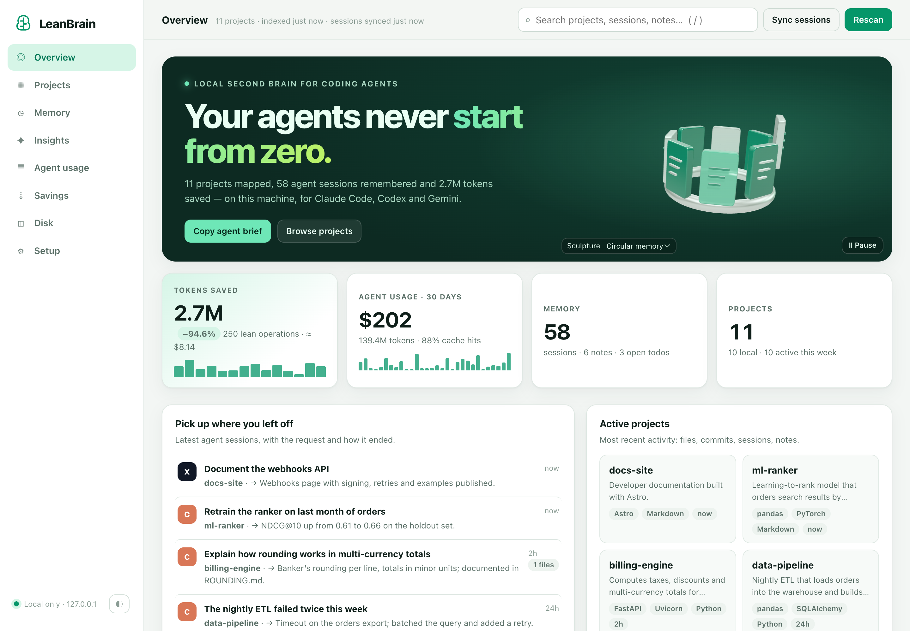
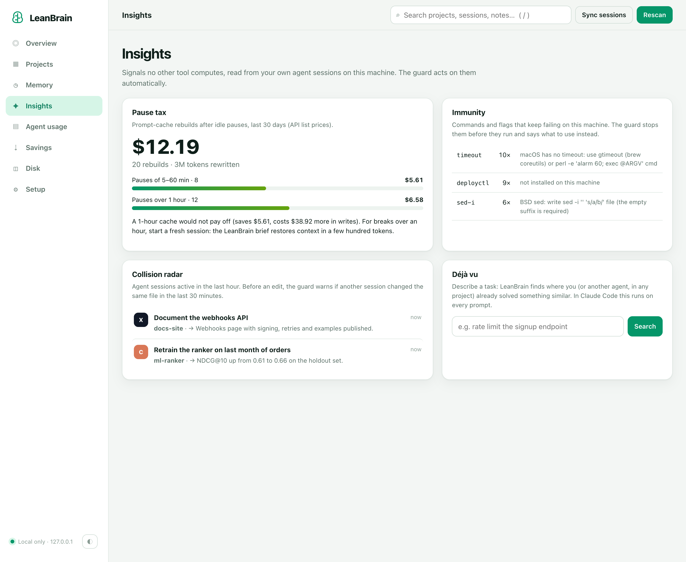
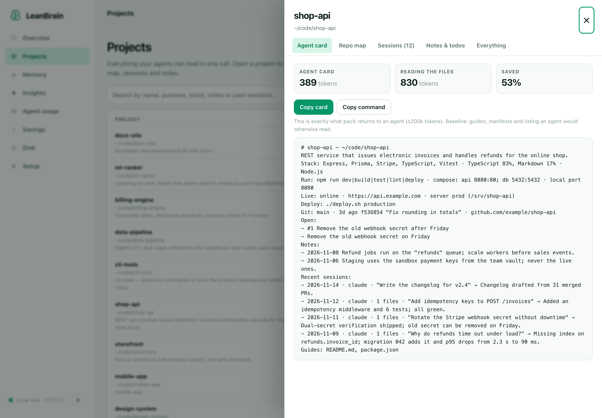
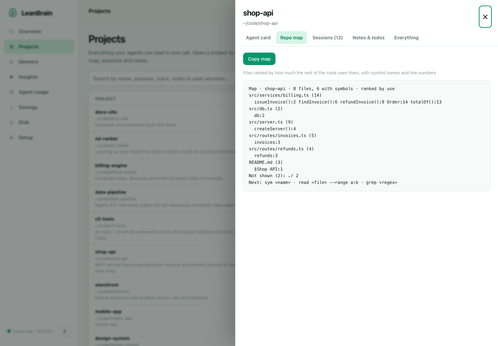
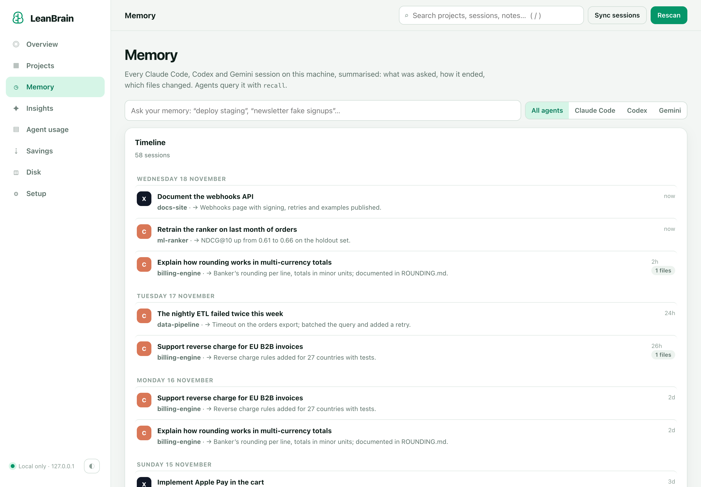
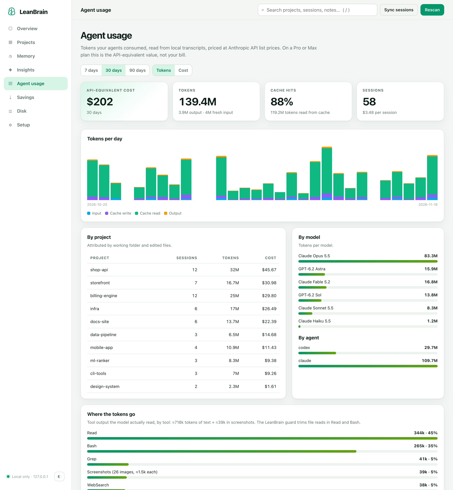
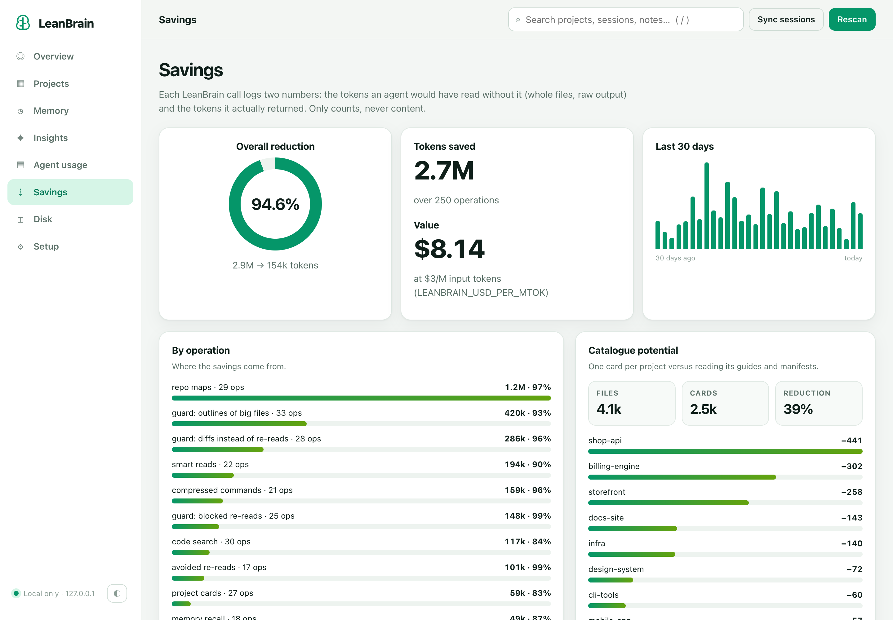

<div align="center">

# LeanBrain

**The lean second brain for coding agents.**
Persistent project memory, an automatic token guard and insights no other tool computes —
for **Claude Code**, **Codex** and **Gemini CLI**.

[](https://github.com/Mic-Fundraiser/LeanBrain/actions/workflows/test.yml)
[](LICENSE)


<picture>
  <source media="(prefers-color-scheme: dark)" srcset="docs/screenshots/overview-dark.png">
  
</picture>

</div>

Your agents forget every project between chats, re-read the same files, print whole files through the shell, retry commands that never worked on your machine, and pay to rebuild the prompt cache after every coffee break. LeanBrain fixes that **locally**, with one Node.js script and no account:

- 🧠 **Memory that writes itself** — every Claude Code, Codex and Gemini session is summarised automatically (request, outcome, edited files, tokens). Agents get it back as a 500-token project card.
- 🛡️ **Token guard** — Claude Code hooks answer big file reads with an outline, re-reads with a one-line stub, re-reads after edits with a diff. Works on `Read` *and* on `cat` / `sed -n` / `head` / `tail` in Bash.
- ✦ **Insights nobody else computes** — *pause tax*, *immunity*, *déjà vu* and *collision radar* (below).
- 📈 **Usage you can act on** — tokens and API-equivalent cost by day, project, model and tool, plus the fixed context every call re-reads.

Works with the current models — **Claude Opus 5.5, Claude Fable 5.2, Claude Sonnet 5.5, Claude Haiku 5.5, Claude Mythos** — and with **OpenAI GPT‑6.2 Astra and GPT‑6.2 Sol** in Codex, including their prices.

## Quick start

Requires Node.js 20+.

```sh
git clone https://github.com/Mic-Fundraiser/LeanBrain.git ~/leanbrain
cd ~/leanbrain && npm ci && npm link        # npm link puts `leanbrain` on your PATH
leanbrain scan ~/code ~/work                 # the folders that hold your projects
leanbrain install --guard                    # agent rules + the Claude Code token guard
leanbrain serve                              # dashboard on http://127.0.0.1:4317
```

Prefer to let an agent do it? Paste the repository link into Claude Code or Codex: it follows [AGENTS.md](AGENTS.md).

Want to look first? `npm run demo` builds a fictional workspace (projects, sessions, savings) in a temp folder and serves the dashboard on it. Your data is never touched.

## Insights no other tool computes



| | What it does | How it acts |
|---|---|---|
| **Pause tax** | Measures what prompt-cache rebuilds after idle pauses cost you, split into 5–60 min and over-an-hour pauses, and computes whether a 1-hour cache (`CLAUDE_CODE_PROMPT_CACHE_TTL=1h`) would actually pay off for *your* pattern. | `leanbrain pauses`; when you come back after a long break with a big context, a one-line notice tells you what this turn will rewrite. |
| **Immunity** | Learns from failed commands in your own sessions: tools that are not installed (`timeout`, `gh`, …), GNU-only flags on BSD/macOS (`sed -i`, `grep -P`, `readlink -f`, `date -d`), missing Python modules. | The guard stops those commands *before* they run and says what to use instead. Facts appear in the session brief. |
| **Déjà vu** | When you ask for something, finds past sessions — in any project, by any agent — that already solved something similar, with the outcome and the files they changed. | Injected automatically at prompt time in Claude Code; `leanbrain dejavu "<request>"` anywhere. |
| **Collision radar** | Sees other agent sessions (Claude Code or Codex) working in the same project, and the files they edited. | Before an Edit/Write, warns once if another session changed that file in the last 30 minutes; at prompt time, tells the agent who else is active here. |

## Token guard

`leanbrain install --guard` adds four Claude Code hooks (`PreToolUse`, `SessionStart`, `UserPromptSubmit`, `PreCompact`):

| Situation | Instead of… | The agent gets |
|---|---|---|
| First whole read of a large file (> ~8k tokens) | thousands of lines | an outline with line numbers, to read only the needed ranges |
| Re-read of an unchanged range (Read, `cat`, `sed -n`, `head`, `tail`) | the same text again | a one-line "unchanged since you read it" stub |
| Whole re-read after the file changed | the full file | just the diff |
| A command that always failed here | a failing call + retry | the fix (immunity) |
| Editing a file another session just changed | a silent overwrite | a radar warning |
| Session start / after `/compact` | blind exploration | the brief + the card of the project it is in |

Safety first: every decision **fails open** (any error = allow), and **repeating the same call always goes through**, so an agent is never stuck. `leanbrain uninstall --guard` removes the hooks; settings are backed up before every change.

## Lean context tools

| Need | Command |
|---|---|
| Start of a chat | `leanbrain brief` |
| Orient in a project (≤500 tokens: purpose, stack, run/deploy, git, open items, notes, last sessions) | `leanbrain pack .` |
| Find a project (typo tolerant, ranks by notes and past sessions too) | `leanbrain find invoices api` |
| Code structure: files ranked by how much the rest of the code uses them, with symbols and line numbers | `leanbrain map .` |
| Where is it defined | `leanbrain sym createInvoice` |
| Search code, grouped by file and budgeted | `leanbrain grep "createInvoice" --glob "*.ts"` |
| Read a file: outline for big files, ranges, diffs on re-reads | `leanbrain read src/app.py --chat k7` |
| Noisy commands: failures + summary only, exit code kept, full log on demand | `leanbrain run -- npm test` · `leanbrain show <id>` |
| Past work | `leanbrain recall rate limit signup` |
| Remember | `leanbrain note . "Deploy with ./deploy.sh"` · `leanbrain todo . "Rotate webhook secret"` |

<table><tr>
<td></td>
<td></td>
</tr></table>

## Memory that writes itself

`leanbrain sessions --sync` (also run by `scan`, the dashboard and the guard) reads Claude Code (`~/.claude/projects`, subagents included), Codex (`~/.codex/sessions`) and Gemini CLI (`~/.gemini/tmp`) transcripts — only the bytes added since the last sync, so gigabytes of history are indexed in seconds and then in milliseconds. Each session keeps its first and last request, the final answer, edited files, tool counts, failures and token usage per model, and is attributed to the project whose files it edited.



## Usage, cost and fixed context

- `leanbrain usage` — input, cache write, cache read and output tokens with API-equivalent cost, `--by day|project|model|agent|tool`. Prices for Claude (Opus 5.5, Fable 5.2, Sonnet 5.5, Haiku 5.5 and earlier) and GPT‑6.2 Astra/Sol are built in; add others in `~/.leanbrain/prices.json`. On Pro/Max plans this is the value of what you used, not your bill.
- `leanbrain usage --by tool` — where tokens go: which tools fill the context, and screenshots counted separately.
- `leanbrain audit` — the fixed context every model call re-reads (CLAUDE.md and its imports, project instructions, skill descriptions, start-up hooks) and what it costs per month.
- `leanbrain gain` — tokens saved by LeanBrain, per operation.



## How savings are measured

Every LeanBrain decision logs two counts: what the agent would have read without it, and what it received instead (o200k_base tokenizer, on device; the guard uses a fast estimate). Baselines are stated per operation: guides + manifests + listing for `pack`, the covered source files for `map`, raw `grep -rn` output for `grep`, the whole file or requested range for reads, the raw output for `run`. Only numbers are stored, never content.



## MCP

`leanbrain mcp` serves eight tools over stdio — `brief`, `find`, `pack`, `map`, `grep`, `read`, `recall`, `note` — with deliberately terse schemas (tool definitions are paid in tokens by every session). `leanbrain install --mcp` registers them in Claude Code, Codex and Gemini CLI.

## Agent rules

`leanbrain install` adds a short block (≈270 tokens) to `~/.claude/CLAUDE.md`, `~/.codex/AGENTS.md` and `~/.gemini/GEMINI.md` so every chat knows the commands; existing blocks are replaced in place and backed up. `leanbrain status` shows what is installed.

## Catalogues

`leanbrain catalog <folder>` indexes from a JSON catalogue (`dati/progetti.json`, optional `dati/cartelle.json` and `dati/archivi.json`; Italian field names such as `nome`, `descrizione`, `stato`, `url`, `server`, `deploy`, `aperti`). Live URLs, servers, deploy commands and open items then appear in the cards, and entries without a local folder stay searchable. Folders passed to `scan` are kept as extra roots.

## Privacy

Everything stays on your machine, in `~/.leanbrain` (`LEANBRAIN_HOME` to move it). The scanner reads names, sizes and a few manifest files and never opens `.env` files. Notes that look like keys, tokens or passwords are refused. The dashboard listens on 127.0.0.1 only and checks Host and Origin headers. No telemetry, no network calls.

## Commands

```
leanbrain help
```

`brief` · `find` · `pack` · `focus` · `ctx` · `recent` · `map` · `sym` · `grep` · `read` · `run` · `show` · `filter` · `note` · `todo` · `recall` · `sessions` · `usage` · `audit` · `pauses` · `immunity` · `dejavu` · `radar` · `gain` · `scan` · `catalog` · `install` · `uninstall` · `status` · `serve` · `mcp`

## Development

```sh
npm test            # 11 end-to-end tests in temporary homes (no network, no real data)
npm run demo        # fictional workspace + dashboard on :4321
npm run screenshots # README screenshots from the demo (Chrome headless)
```

LeanBrain was previously called *Atlante*: the first run imports `~/.atlante`, `install` replaces old rule blocks, and `atlante.mjs` keeps old commands working.

Contributions are welcome — see [CONTRIBUTING.md](CONTRIBUTING.md). MIT licence.
